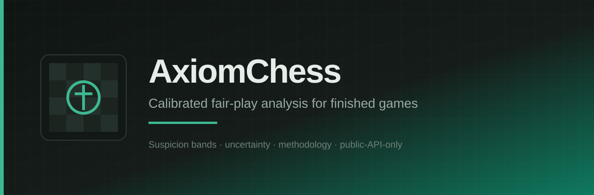

<p align="center">
  
</p>

# design

Design tokens (light/dark), board themes, motion notes, brand assets, and anti-slop checklist for AxiomChess.

## Direction

Ink and Felt: precise, analytical, quiet confidence. Cool chalk and ink surfaces, one emerald felt accent, chess-native board states. Not SaaS-generic.

## Layout

| Path | Role |
| --- | --- |
| `tokens/tokens.json` | Machine-readable source of truth |
| `tokens/tokens.css` | CSS variables for light/dark consumption |
| `tokens/tokens.schema.json` | Shape notes for validators |
| `assets/brand/` | Logo, wordmark, banner, mark SVGs |
| `docs/board-theme.md` | Board squares, states, pieces, a11y |
| `docs/anti-slop-checklist.md` | Banned patterns matching PROJECT_SPEC.md |
| `scripts/validate-tokens.mjs` | Offline acceptance checks |

## Typography

- Display: Syne
- Body: IBM Plex Sans
- Mono (data only): IBM Plex Mono

Never use Inter, Roboto, Arial, or system-ui as the brand face.

## Scripts

```bash
pnpm test
# or: node scripts/validate-tokens.mjs
```

`build`, `lint`, and `test` all run the same validator in this foundation task.

## Consume from web

Import `tokens/tokens.css` (or copy variables) and set `data-theme="light"` / `data-theme="dark"` on a root element. Prefer reading values from `tokens.json` when generating Tailwind theme maps.

## License

MIT. See `LICENSE`.